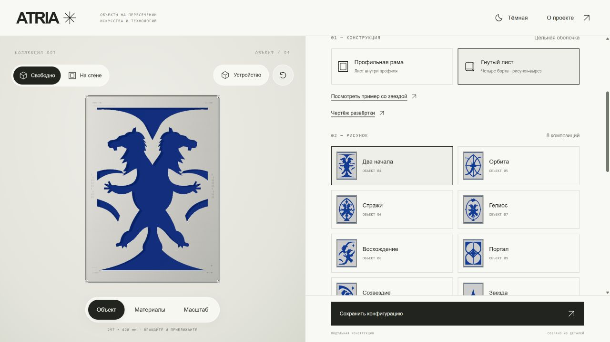

# ATRIA — Metal Canvas

Интерактивный конструктор металлических картин на React, React Three Fiber и Three.js.

**Открыть работающий сайт:** https://jniion01.github.io/atria-metal-canvas/



## Запуск

Нужен Node.js 20.18 или новее; для разработки рекомендуется Node.js 22.

```sh
npm ci
npm run dev
```

Откройте http://127.0.0.1:5175/. Приложение работает в браузере с WebGL. Сервер API, аккаунт ChatGPT и ключи доступа не нужны.

## Проверка и сборка

```sh
npm test
npm run build
npm run preview
```

Готовый сайт находится в `dist/`. Для размещения загрузите содержимое этой папки на статический хостинг. Пути к ресурсам относительные, поэтому сайт работает и в подпапке репозитория.

## Возможности

- Восемь рисунков, форматы A3 и 100 × 150 см.
- Профильная рама и цельный лист с четырьмя гнутыми наружными бортами.
- В режиме гнутого листа рисунок становится сквозным вырезом; внутренние края не гнутся.
- Поэтапная сборка и развёртка со слайдером, угловыми вырезами и припуском на гиб.
- Чертёж развёртки и экспорт SVG в миллиметрах.
- Орбитальное вращение, сброс ракурса и масштабирование модели.
- Текстильные и гладкие подложки, ASCII-гравировка, светлая и тёмная темы.
- Мобильная шторка настроек. Двухпальцевый жест на 3D-холсте масштабирует модель.
- Экспорт выбранной конфигурации в JSON. Оплата и оформление заказа не подключены.

## GitHub Pages

Включите `Settings → Pages → Build and deployment → Source: GitHub Actions`.
Workflow `.github/workflows/pages.yml` проверяет и собирает проект при push в `main`, затем публикует `dist/`. Его также можно запустить вручную. На pull request выполняются только тесты и сборка.

Текущая опубликованная версия доступна по ссылке в начале README независимо от настройки GitHub Pages.

## Структура

| Файл | Назначение |
| --- | --- |
| `src/main.jsx` | Интерфейс, настройки, мобильная шторка, экспорт |
| `src/Scene.jsx` | R3F-сцена, освещение, OrbitControls |
| `src/artwork.js` | Рисунки и описания деталей |
| `scripts/generate-cutouts.mjs` | Получение негативных вырезов и удерживающих перемычек |
| `src/foldedGeometry.js` | Поверхности листа и геометрия четырёх бортов |
| `src/sheetMetal.js` | Развёртка, угловые разгрузки и SVG |
| `src/forming.js` | Последовательность гибки и расчёт припуска |
| `src/textures.js` | Процедурные материалы |
| `scripts/check-*.mjs` | Проверки геометрии, масштаба и жестов |

После редактирования исходных рисунков `npm run build` автоматически обновляет `src/foldedPatterns.generated.js`.

## Ограничения производственного прототипа

Модель предназначена для согласования конструкции. Толщина, радиус, K-фактор и зазоры предварительные; перед резкой требуется пробный гиб, проверка перемычек, ширины реза и доступности инструмента. Угловые стыки не исчезают при гибке: бесшовная отделка требует отдельной операции. Отверстия рисунка остаются плоскими, гнутся только наружные борта.

A3 — размер плоской лицевой части 297 × 420 мм. Наружный габарит собранного листа и размер развёртки показаны отдельно.

## Проверенная версия

Экспорт рабочей версии от 11 ноября 2026 года. Исходная ревизия: `f858f582f8b5215b7e2967c5da4026b747ccb537`.

Исходники не требуют интеграции с хостингом ChatGPT. Служебные идентификаторы публикации, локальные зависимости и история промежуточных версий в экспорт не включены.
